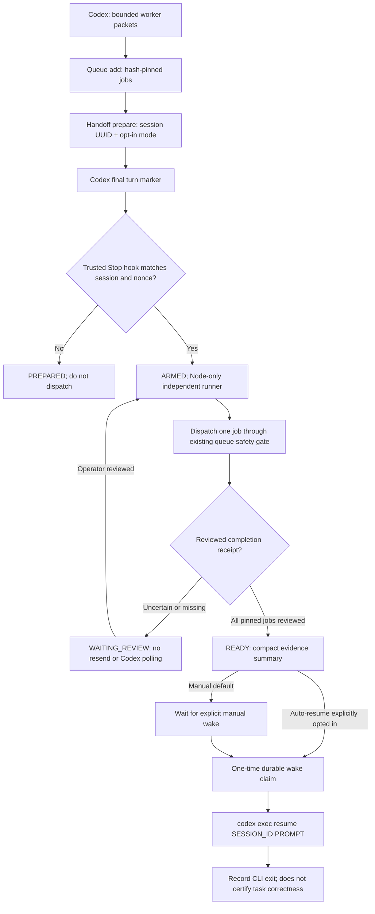

# RCC v0.4.3-preview: Deferred Handoff & Local Event-Driven Wakeup

## Exact guarantee, not marketing

This is a local Node 20+ runner that can continue after a Codex **turn ends**. It does not suspend a running model process using an undocumented Codex API. The Codex turn must finish normally. The local runner then operates independently, receiving changes from local file notifications (with a consistency-timer fallback, default 5 seconds), without Codex LLM polling. The account plugin does not itself launch Chrome, Node or Codex on the user's computer.

The Codex **Stop** hook confirms that a session-specific final assistant message includes the exact marker emitted by `handoff prepare`. Hook execution occurs at the end of a turn; a three-second settling window mitigates, but does not prove absence of, a concurrently active Codex host. Thus automatic resume is opt-in, and actual host integration must be smoke-tested. Hook must be explicitly trusted in Codex; plugin installation alone is not trust. No infinite self-continuation hooks or approval bypass are used.

**Not yet fully autonomous:** the existing RCC queue produces `TRANSPORT_RETURNED` after a zero-exit transport, not an independently verified UI-completion witness. Each such job requires a genuine operator-reviewed `rcc.queue.review.v1` receipt and a real source artifact before the runner dispatches the next queued job. The queue will not auto-advance from uncertain delivery, missing evidence or a negative no-send finding. This limits end-to-end autonomy but prevents the false-completion/duplicate-send failure.

## Architecture and authority



### Guarded source of truth

- Queue state: `.devspace/rcc/CASE/queue.json` (existing v0.4.2 mechanism, preserved).
- Handoff state: `.devspace/rcc/CASE/handoff.json` (includes only job IDs/payload hashes, session UUID, control state, no raw worker messages).
- Result: `.devspace/rcc/CASE/handoff-summary.json` (bounded reviewed artifact references, not full transcript).
- Codex wake log: `.devspace/rcc/CASE/codex-resume.log` (permissions 0600; may contain sensitive text; do not share blindly).
- Independent-process lock: `.devspace/rcc/CASE/deferred-runner.lock` (do not delete without verifying the process has stopped).

Pinned job array must stay exactly the same, with the same hash. The runner never guesses a new worker room and never repairs queue uncertainty by retrying. The wake event is claimed before invoking Codex. A process crash between claim and process return leaves `RESUME_CLAIMED` or `RESUME_UNCERTAIN` and requires investigation; no implicit second invocation. Resume process exit 0 means only **the CLI exited**, not proof of correct changes or canonical epistemic closure.

## End-user workflow from one chosen local project directory

Prerequisites: complete **local** RCC v0.4.3 installation, Node >=20, Codex CLI installed and authenticated for opt-in resume, supported Chrome CDP profile logged in, worker rooms bound. Run all commands from the *same working directory* (the selected project root), while using the correct absolute `PLUGIN_ROOT` path.

```sh
# 1. Inspect the complete installed release and actual Chrome binding
node "$PLUGIN_ROOT/bin/rcc-consortium" selftest
node "$PLUGIN_ROOT/bin/rcc-consortium" browser doctor
node "$PLUGIN_ROOT/bin/rcc-consortium" workers list --case=study

# 2. Enqueue pinned worker files; this does NOT send
node "$PLUGIN_ROOT/bin/rcc-queue" queue add --case=study --role=constructor --prompt-file=constructor.md
node "$PLUGIN_ROOT/bin/rcc-queue" queue add --case=study --role=skeptic --prompt-file=skeptic.md

# 3. Start the runner in a SEPARATE terminal on the same project folder
node "$PLUGIN_ROOT/bin/rcc-deferred" handoff run --case=study

# 4. Inside Codex, prepare the handoff with the actual /status session UUID
node "$PLUGIN_ROOT/bin/rcc-deferred" handoff prepare --case=study --session=ACTUAL-CODEX-UUID
# Append the emitted HANDOFF_ACCEPTED:<nonce> marker verbatim to the Codex final response.
# End the Codex turn. Trusted Stop hook arms RCC; Codex can now be idle.

# 5. When a job reaches TRANSPORT_RETURNED, independently inspect its actual
# ChatGPT history and transport receipt, then create an honest review JSON.
node "$PLUGIN_ROOT/bin/rcc-queue" queue review --case=study --job=ACTUAL-JOB-ID --receipt-file=review.json
# Runner notices the reviewed queue and can dispatch its next pinned job.

# 6. Manual/default: After all jobs are REVIEWED_WITNESS, inspect
node "$PLUGIN_ROOT/bin/rcc-deferred" handoff status --case=study
node "$PLUGIN_ROOT/bin/rcc-deferred" handoff wake --case=study --approve=WAKE-study
```

`handoff wake` explicitly launches `codex exec resume ACTUAL-CODEX-UUID` from the recorded project directory. It is not a TUI wakeup and may use Codex quota. It supplies a short prompt referencing the summary file. Do not assume it will appear inside an already-open interactive TUI. If the manual wake should remain truly manual in the Codex application, run `codex resume <UUID>` yourself instead of `handoff wake`.

### Auto-resume explicitly opted in

Replace the prepare command with:

```sh
node "$PLUGIN_ROOT/bin/rcc-deferred" handoff prepare --case=study --session=ACTUAL-CODEX-UUID --auto-resume
```

The independent local runner will make **at most one** `codex exec resume` attempt per handoff, only after every pinned job is `REVIEWED_WITNESS`, required source artifacts still exist, and the trusted Stop hook has armed the case. A resume failure stays unresolved and is not automatically retried.

**If hooks are unavailable or not trusted**, Codex will not arm automatically. After its turn genuinely finishes, explicitly arm via:

```sh
node "$PLUGIN_ROOT/bin/rcc-deferred" handoff arm --case=study --session=ACTUAL-CODEX-UUID --marker=HANDOFF_ACCEPTED:ACTUAL-NONCE
```

Use a *separate, independently running terminal* for the runner. Invoking a blocking `handoff run` as the final shell call inside the active Codex turn defeats the purpose; it prevents the turn from finishing and cannot save waiting tokens.

## Threat model and scope limits

1. **Review spoofing:** a manually supplied `rcc.queue.review.v1` receipt is an operator assertion, not a cryptographic UI proof. The runner verifies receipt metadata and existence of its source file; a malicious reviewer can fabricate both. Real browser-witness automation requires separate implementation and live validation.
2. **Concurrent Codex:** a Stop hook + grace period does not guarantee no other Codex process is using the same session. Never auto-resume the same session concurrently from other clients; test on the target Codex host and use `--auto-resume` only under controlled conditions.
3. **Locks:** runner, handoff and queue locks guard this local CLI path. Direct `worker send` outside the queue remains uncoordinated; use one dispatch path per case. After a crash, inspect the PID and queue before touching stale lock files; do not indiscriminately delete locks.
4. **Privacy and authority:** no tokens, credentials, full DOM or hidden chain-of-thought are exported. The resume prompt may instruct an agent to continue, but cannot grant file write/terminal authority that the user did not already provide. Do not use approval bypass flags. A user must authorize auto-resume and trust the Stop hook locally.
5. **No invented savings:** Codex calls eliminated during idle intervals can reduce token usage; starting/resuming Codex still consumes usage, and ChatGPT Web consultations have separate limits. There are no measured quota savings in this release.
6. **No guaranteed daemon persistence:** this is a foreground runner in a separate process, not an OS service. Closing its terminal stops the runner. A dedicated service manager can be configured by the user later but is not silently installed.
7. **Platform coverage:** synthetic Node tests, not live Windows/Chrome/Codex E2E or proof of lifecycle hook activation. Portable `node`/Codex executable paths and plugin hook substitution should be checked on the target host.

## Tests

```sh
npm run test:deferred
npm run test:queue
npm run test:completion
npm run test:distribution
```

Do not mark completion or resume correctness `PASS` based solely on these tests. Live verification requires a separate bound-room/UI send, anchored response completion, real review artifact and one resumed Codex session with clear process outcome.

External references: https://learn.chatgpt.com/docs/cli/reference (Codex exec resume); https://developers.openai.com/plugins/build/plugins (plugin hooks); https://developers.openai.com/docs/hooks (Stop and trust model).

### Windows PowerShell equivalent

```powershell
$P = 'C:\\Path\\To\\Full\\Installed\\RCC'
# In the project's working directory, not inside plugin cache:
node "$P\\bin\\rcc-queue" queue add --case=study --role=constructor --prompt-file=constructor.md
# Launch in a separate PowerShell terminal (the script remains running):
node "$P\\bin\\rcc-deferred" handoff run --case=study
# During the Codex turn, create the handoff; use exact UUID observed in /status:
node "$P\\bin\\rcc-deferred" handoff prepare --case=study --session=ACTUAL-CODEX-UUID --auto-resume
# Keep the runner terminal running until a reviewed completion artifact arrives.
```

No Windows Task Scheduler registration, auto-start, background service installation, or MCP connection is performed by plugin installation.
