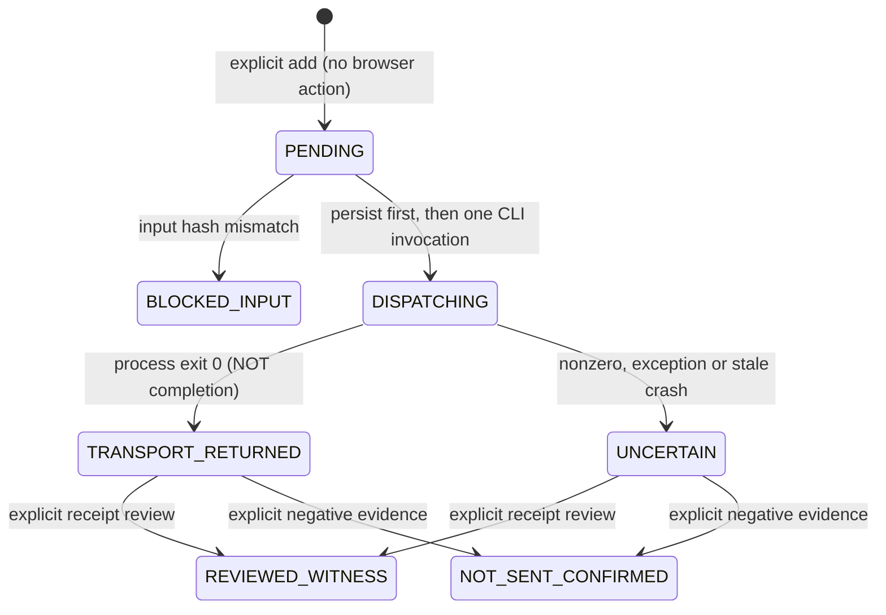

# RCC v0.4.2-preview — conservative queue manager

This is a local Node >=20, dependency-free **C0 serial dispatch queue**, not an MCP service, browser extension, parallel multi-agent scheduler or cloud worker. The RCC account plugin cannot run this queue or mutate the user's filesystem. The queue launches the existing `rcc-consortium worker send` CLI **only when the user explicitly runs** `queue run`. It keeps worker-room bindings in RCC's existing state file; it never creates or reparents tabs. Direct `rcc-consortium worker send` calls made outside this queue are outside its lock and are not coordinated with it.

## Separate submission, transport and completion



**Invariants:** No *completed* or canonical closure is inferred from process exit zero, missing Stop button, stable text, a created tab, an uploaded file, an observed assistant-count increase, or a clicked Send button. `TRANSPORT_RETURNED` is unresolved until a human or independently verified browser receipt is reviewed. One unresolved job freezes the case queue. No implicit retries, requeues, or resends. A negative no-send finding closes a job but does not resend it; any subsequent attempt must be a separately reviewed new enqueue.

## Local CLI

Run in the extracted RCC plugin directory with `node bin/rcc-queue`; data is in the **current working directory's** `.devspace/rcc/CASE/queue.json`. The CLI does not install or start anything persistently.

```sh
# Prepare RCC workers and inspect browser readiness separately, using the existing CLI:
node bin/rcc-consortium browser doctor
node bin/rcc-consortium workers list --case=study
# Add without sending; pin each prompt/file byte hash and optional exact UI model/level labels:
node bin/rcc-queue queue add --case=study --role=constructor --prompt-file=constructor.md --model="GPT-6" --level="High"
# Inspect the case queue and existing unresolved jobs:
node bin/rcc-queue queue list --case=study
# Explicitly send at most ONE pending job. This may send a real ChatGPT message:
node bin/rcc-queue queue run --case=study
# Reconcile with an operator-reviewed artifact, not just process output:
node bin/rcc-queue queue review --case=study --job=ACTUAL_JOB_UUID --receipt-file=review.json
# Only for a crashed/abandoned lock after checking there is no live worker:
node bin/rcc-queue queue recover --case=study --approve=RECOVER-study
```

`--upload-file=<path>` may be repeated on `add`. Each prompt is capped at 2 MiB; each attachment at 32 MiB for local hashing. The manager keeps hashes, paths and minimal event data, not raw prompt contents or response transcript. Source changes between add and dispatch produce `BLOCKED_INPUT` with **no send**. `--key=<id>` explicitly sets an idempotency key; if it is reused for a different packet, the add is refused.

## Receipt contract

Only `rcc.queue.review.v1` is accepted. The receipt must match the case, role and job UUID. For `decision=witnessed`, `witness.userEchoVerified` and `witness.completionVerified` must both be true, assistant-to-user anchors must match, the evidence type must be `observed_active_then_stable_inactive` or `anchored_terminal_controls_and_stability`, and the assistant response must have a SHA-256 digest. It must name the reviewer and the source artifact. This is an **operator assertion**, not cryptographic verification against the live ChatGPT UI. The status is deliberately `REVIEWED_WITNESS`, never auto-`CANONICAL`.

```json
{
  "schema": "rcc.queue.review.v1",
  "jobId": "<actual job UUID>",
  "caseId": "study",
  "role": "constructor",
  "decision": "witnessed",
  "reviewer": "reviewer's identifier",
  "sourceArtifact": "local path of reviewed session receipt",
  "witness": {
    "userEchoVerified": true,
    "userAnchor": "actual-user-message-anchor",
    "assistantBoundToUserAnchor": "actual-user-message-anchor",
    "completionVerified": true,
    "completionEvidence": "anchored_terminal_controls_and_stability",
    "assistantTextSha256": "<64-character actual sha256 hex>"
  }
}
```

If the browser history establishes no send occurred, use `decision=not_sent` with nonempty `reviewer`, `sourceArtifact`, and a reason of at least 20 characters. Do not mark not-sent without observing actual conversation history/receipts. The queue only checks schema/evidence fields, not whether a reviewer genuinely inspected that history.

## Recovery / risk boundary

Each queue operation uses an exclusive `queue.lock` file and atomic state rename. The lock spans the awaited child operation, so two queue CLI instances cannot issue overlapping queued sends. A hard crash can leave `DISPATCHING` and/or a stale lock. Recovery requires an explicit case-specific approval, rejects a lock with a live (or indeterminate) owner and conservatively converts stranded `DISPATCHING` to `UNCERTAIN` without retry. Investigate the browser history before any new job.

**Known limits:** No cross-process coordination with manually invoked RCC commands; no cross-case global lock in this manager (the vendored browser transport supplies its own global operation lock); no distributed lease; no queue daemon or scheduled drain; no UI selector proof or live Windows CDP witness; non-transactional timing between content hash validation and the child process; recovery is not a replacement for browser history reconciliation; review receipts can be falsified by their author. Actual successful response completion still requires live validation of the separately staged `completion-guard` patch in the selected local installation.

## Test commands

```sh
npm run test:queue
npm run test:completion
npm run test:distribution
```

`test:queue` uses synthetic child-executor results and temporary local files. It proves process-state transition and anti-retry logic in isolation, not successful ChatGPT web browser delivery.
