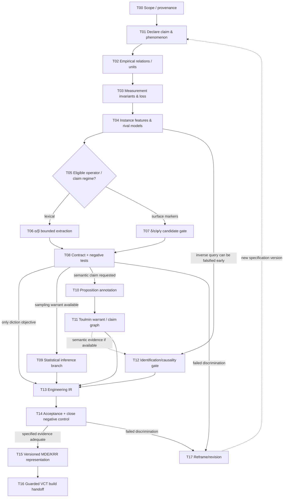

# Heuristic Model Derivation: Mathematical Mental Models for VibeCode Transducer

**Type:** source-grounded literature review, critique, and conceptual task derivation  
**Date:** 2026-10-23  
**Status:** `RESEARCH_SYNTHESIS / PROPOSED_TASK_GRAPH`; no VCT runtime, source-code patch, or semantic classifier executed.

## Executive finding

The answer is **yes, selectively**: several entries in the existing mathematical `MATH-001`–`MATH-099` registry provide constraints, representation operators, inference tests, and falsifiers useful for engineering heuristic selection. But **the inventory is not yet a knowledge-based strategy selector**. The missing middle is a typed relation among a problem's epistemic goal, its observed structure, eligible mathematical methods, the warrant needed to make a claim, and the engineering tests that can falsify the translation.

The inherited registry has **99, not 100** entries. `MATH-100` in the companion crosswalk is a clearly marked **candidate addition**, *Buckingham Π / dimensional grouping*, not a retroactively claimed 100th entry. The separate VCT lateral atlas contains methods numbered `031`–`080`; they are **not** the same as `MATH-031`–`MATH-080`. Use namespaces like `MATH-034`, `ATLAS-034`, `META-SELECT-001`.

The proposed literature-grounded control principle is:

`problem/phenomenon -> conceptual claim -> empirical relational structure -> observation model -> admissible mathematical representation -> inference and its limitations -> falsifying test -> versioned engineering task graph`.

This integrates but does not conflate **Toulmin** (argument warrant), **Mahajan** (heuristics and model-space revision), **Rice** (instance-sensitive algorithm selection), and **MDE/KRR** (model/specification representation). These are different explanatory jurisdictions.

## 1. Corpus and provenance

Inspected primary user-supplied materials:

- `SECOND_ORDER_MODELS_v1.3.md` (64 source lines in indexed version; full local Markdown also read). A requirements/contract document for a local offline `index.html`, not an evaluated data corpus and not the application's actual source code.
- `StreetfightingMathematics.pdf`, Sanjoy Mahajan, *Street-Fighting Mathematics* (MIT Press, 2010), 153 PDF pages in this local copy; **printed page numbers** are used below. Its six tools are dimensions, easy cases, lumping, pictorial proofs, taking out the big part, and analogy.
- `math_dsl_operator_registry.csv` inherited from the prior turn; 99 `MATH-001`–`MATH-099` items. Original `reference_ids` are retained in companion CSV but not all original references or theorems were re-verified independently in this turn.
- `math_dsl_literature_review.md` inherited prior synthesis; useful orientation, not independent source testimony.
- Installed VibeCode Transducer skill and its `atlas-and-routing.md`: historical `ATLAS-031`–`ATLAS-080`, reference inventory, narrow current runtime portions for Jaccard, MAD, topological sorting; the skill itself does not start the runtime.

Public literature anchors below were retrieved and inspected at abstract or article-page level; access to a source does not mean its claimed theory was formally reproduced or tested.

## 2. Term-sense repair: *unidimensional* is not *dimensionless*

There are **three separate claims** that can be hidden behind 'uni non-dimensional':

1. **One observed indicator:** e.g. the scalar `r_3(z|a)`. It is a single numeric feature, not automatically a unidimensional psychometric/semantic construct.
2. **Dimensionless ratio:** a count of matched spans divided by a count of legal spans has no physical length/time/mass dimension, though its *observation unit*, denominator, tokenization convention, and sampling dependence remain important.
3. **Unidimensional latent construct:** a claim that one factor (e.g. rhetorical synthesis) explains observations. This requires construct theory and independent validation; no count ratio alone establishes it.

Mahajan (2010, chapter 1, printed pp. 1–10) distinguishes physical dimensions from units, including the warning that making everything numerically unit-free can discard useful constraints. In chapter 2, printed pp. 23–26, he derives dimensionless groups to reduce an underconstrained physical model. Buckingham Π is useful **only when a defensible quantity/dimension matrix and transformation law have been specified**. It does **not** prove that linguistic counts are adequate indicators of semantic categories. The philosophical literature on measurement likewise distinguishes empirical relational structures, representations, and the validity of interpreting numerical measurements (Tal, 2020; *Working with Concepts*, 'Measurement Validity,' 2026).

Let `E` be an empirical relational system and `N` a numerical/formal structure. A measurement representation `m:E->N` must specify which empirical relations are preserved. For lexical counts, `m` can preserve exact span membership under the declared tokenizer. For rhetorical function, preservation has **not been shown** without validated proposition/argument annotation.

## 3. The exact Co-Domain v1.3 evidence boundary

### α — anchored contextual distribution

Inputs are anchor phrase `A`, optional `B`, tracked `z`, and document/paragraph/sentence/token indices. An observation is **one occurrence of `A` within a sentence**. Backward windows `W3={p-2,p-1,p}` and `W5={p-4,...,p}` are clipped to corpus start. For `m`-token `z`, count contiguous matched spans `c(z,Wk)` and all legal *same-sentence* candidate starts `N_m(Wk)`:

`r_k(z|a) = c(z,W_k(a))/N_m(W_k(a))`, when `N_m>0`.

`r3-r5` is a **descriptive comparison of two overlapping dependent windows**; it is not an independent two-sample test, a probability of a discourse act, or evidence of causal writing success. The next `B` is searched within at most three subsequent paragraphs; if missing, `lag=null` signifies censoring (never lag 0). There is an **80-anchor evaluation cap**, with `anchor_count`, `events_evaluated`, and `events_truncated` maintained separately. Statistics of lags are only over evaluated complete endpoints.

Claim licensed by α: *within this measured corpus view and specified normalization, a pattern appears at the documented offsets, with the observed counts and denominators.* Not licensed: *the author intends recapitulation* or *the phrase carries a specified rhetorical relation in all contexts*.

### β — lexical discontinuation and re-entry

For consecutive occurrences of z, `g_i=start(z_(i+1))-end(z_i)-1` in word tokens plus whole paragraphs. For complete X→Y intervals only, the bounded silence ratio is `complete intervals with c(z,(X,Y))=0 / all complete intervals`. Missing Y is censored; zero or one occurrence of z cannot support recurrence claims.

Claim licensed by β: *lexical absence/presence within exact scoped intervals*. Not licensed: *semantic discontinuation*; pronouns, anaphora, synonyms, indirect reference remain outside its observation type.

### δ, ε, φ, γ — candidate gates, not semantic estimators

- δ: evidence surface markers -> possible attribution spans; no scope/coreference resolution.
- ε: consequence markers -> conclusion candidates; no complete proposition-level argumentative classification.
- φ: conditional/negation/coordination markers -> possible logical-operator locations; must remain `status=not_formal_proof`.
- γ: repeated character suffixes -> orthographic proxies; not morphological parsing.

These distinctions are **already binding** in the v1.3 contract. They must survive any VCT handoff. Sections 03, 04, and 05 have distinct ownership: observation, evidence-bound editorial candidates, and human steering. Default human choice is `none`; only explicit `preserve/increase/reduce/exclude/add/customize` becomes an optional instruction. The export schema `corpus-to-codomain/unified-1.1` and its existing fields must remain unchanged; extensions live under the documented namespace.

## 4. Toulmin: proof obligations at each inferential bridge

A conceptual pattern extraction must distinguish:

| Toulmin position | The Co-Domain case | Status / required warrant |
|---|---|---|
| **Data (D)** | Exact spans, windows, counts, denominator, excerpts, censored endpoints | Observation with reproduction trace; actual corpus still needed for numerical claims |
| **Claim C_obs** | `r3(z|a)>r5(z|a)` on a specified anchor | Descriptive inequality from measured counts; check arithmetic and denominators |
| **Warrant W_obs** | Tokenizer, normalization, no sentence crossing, mask provenance, scope of `N_m` | Code/contract correspondence verified by unit and negative tests |
| **Backing B_obs** | Corpus record, spans, regression receipt, independent fixture | Source and test witnesses, not the label of an algorithm |
| **Claim C_sem** | `A` performs rhetorical synthesis / `z` is semantically absent | Not established by C_obs; requires semantic annotation and a bridge model |
| **Warrant W_sem** | Validated relation between surface features and interpreted propositions | Annotated examples, explicit scheme, reliability and out-of-domain tests |
| **Qualifier Q** | `within measured view`, `candidate`, `under specified assumptions` | Must limit claim strength |
| **Rebuttal R** | Quoted marker, genre/topic confound, pronoun reference, censorship, overlap, limited coverage | Counterexample preserved; not silently discarded |

Toulmin is an architecture of argument **relations**, not a parser, probability theory, or warrant-quality meter. Research by Jo et al. (2019) explicitly distinguishes full proposition extraction from merely using segmented textual surfaces. Habernal et al. (2018) treats implicit warrant reconstruction as a separate task. A Toulmin marker detector therefore cannot emit `PROVED` by itself.

## 5. Mahajan: selected non-linear heuristic operations, with provenance

| Mahajan method | Primary-source location | Characteristic problem / derivation | What prevents over-transfer to Co-Domain |
|---|---|---|---|
| **Dimensional analysis** | Ch. 1 pp. 1–10 | Suspect scale inconsistency; derive admissible quantity dependence | Lexical rate is dimensionless numerically but can be semantically invalid |
| **Easy cases** | Ch. 2 pp. 13–20 | Reject candidate model at zero/equality/extreme cases; generate a better form | Passing finite tests is not proof of all linguistic uses |
| **Dimensionless groups** | Ch. 2 pp. 23–26 | Reduce physical functional degrees of freedom from dimensions | Needs meaningful dimension matrix; token count units are not physical dimensions |
| **Lumping** | Ch. 3 pp. 31–53 | Replace detailed variation by approximate aggregate at declared error tolerance | Aggregation destroys offset/semantic evidence unless raw traces are retained |
| **Pictorial proof** | Ch. 4 pp. 57–74 | Find a structure-preserving geometric explanation for an identity | Visualization of lexical graph is not a logical proof of meaning |
| **Taking out the big part** | Ch. 5 pp. 77–97 | Baseline + correction/residual; quantify whether the discarded part matters | The remainder must be typed; not a generic unexplained semantic `δ` |
| **Analogy** | Ch. 6 pp. 99–121 | Transfer structure from simpler familiar analog, then test point of failure | Similar words or output graphs cannot license equivalence of mechanisms |

**Especially informative witness:** Printed pp. 19–20 (Mahajan, §2.3). A truncated-pyramid model initially based on obvious symmetrical terms produced a wrong coefficient. The correction retained prior constraints but *expanded the hypothesis space to include the cross term* `ab`, yielding `V = h(a²+ab+b²)/3`. This supports a **heuristic strategy**: when held-out easy cases fail, reconsider *model grammar*, rather than retune numerical coefficients in a deficient grammar. It does **not** establish a formula for rhetorical structures.

## 6. Rice-type selection: match problem structures to licensed operators

For each problem `p`, define a **task-relative** feature signature, not a universal psychometric vector:

`F(p) = {object_type, requested_claim_type, observation_unit, granularity, ordering, dependency/censoring, corpus_scope, data_availability, invariances, desired_error_tolerance, execution_constraints, required_evidence}`.

For each mathematical operator `o`, define its affordance contract:

`A(o) = {input_types, output_types, assumptions, information_loss, inference_ceiling, counterexample, computational_cost, implementation_state}`.

Do not flatten these heterogeneous properties into an arbitrary numeric score. First apply hard admissibility:

`Eligible(o,p,c) := TypeMatch(o,p) AND PreconditionsKnown(o,p) AND RepresentationWarrant(p) AND SupportsClaim(o,c) AND FalsifierSpecified(o,p,c)`.

Then, **among eligible alternatives**, compare actual task-relative quality criteria (e.g. correctness witness, interpretability, resource/time budget, reproducibility), use Pareto comparison or declared priorities, and allow `NO_ELIGIBLE_OPERATOR` / `NEED_DATA` as real outcomes. Rice's feature-based algorithm selection is the conceptual precedent; this particular typed constraint formulation is a **new design synthesis**, not a verbatim theorem of Rice.

A **non-linear task structure** is an AND/OR dependence graph:

- `AND` predecessors: all are prerequisites before the task is admissible.
- `OR` alternatives: only the model appropriate to the claim regime is selected.
- Feedback: a failed discriminating test yields a **new revision** of the problem model/task graph; don't silently loop a committed graph or claim its previous PASS remains valid.
- Costly semantic, statistical and causal branches **must not execute** if the user task merely asks for diction-level surface features.

## 7. Crosswalk to mathematical IDs (selection highlights)

The companion CSV evaluates each original `MATH-001` to `MATH-099`, retains original theorem prerequisites and falsifiers, and adds **new editorial relevance**, inferential limit, and VCT task IDs. The classification is *judgment about applicability to this particular source case*, not a claim that every row is a heuristic or implementation.

Selected high-leverage bridges:

- `MATH-007` counterexample + `MATH-008` equivalence: determine whether `marker -> role` is a mere one-direction candidate and find exceptions.
- `MATH-009/010` set operations/inclusion-exclusion: keep exact matched spans, overlapped windows and candidate universes separate.
- `MATH-027/032` nullspace and projection: model information loss when text becomes feature vectors; non-injective summaries are not invertible without other data.
- `MATH-043` finite difference: exact discrete gap/sequence arithmetic for β, not continuous derivative by default.
- `MATH-044/045/047/048/049/050/054/055`: distinguish empirical counts from probability models; laws requiring i.i.d./regularity cannot be imported automatically for overlapping anchored windows.
- `MATH-058/061`: typed graphs of argumentative relations vs actual task dependencies; topological sorting requires DAG.
- `MATH-088/091`: inverse identifiability and abductive candidate selection; failure to identify author intent is a real result.
- `MATH-090`: causal effect of changes to writing quality requires interventions and assumptions not present in corpus patterns.
- `MATH-092–099`: knowledge and engineering representation (RDF, OWL, SHACL, Datalog, SMT, lenses, metamodels, proof assistant), each with noninterchangeable semantics.
- `MATH-071–087`: geometric/topological operators **are not currently licensed** by α/β merely because a text sequence can be plotted as points or a graph. They require a separately defended geometry, metric, filtration, or topological object. Not using them is mathematically disciplined selection.
- `MATH-100` **proposed only**: Buckingham Π group reduction for properly dimensioned quantities (see §2); not a direct NLP semantics detector.

Namespace collision: `ATLAS-034` = Jaccard, while `MATH-034` = limit/continuity. The plugin's Jaccard, MAD and topo-sort support is narrow, and is not evidence that its larger method inventory has been implemented.

## 8. Worked derivation: α as a descriptive operator, not a rhetorical verdict

**Case (hypothetical, not measured corpus output).** Declare `A="Dengan demikian"`, tracked `z="kesimpulan"`, target `C_obs` = local frequency contrast. Assume legal observation counts `c3=3, N3=40, c5=5, N5=80` on one fixed anchor. Then:

`r3=3/40=0.075`, `r5=5/80=0.0625`, and `r3-r5=0.0125`.

- The numbers are dimensionless numerical rates per legal candidate span **within those specified windows**.
- Because the windows overlap, difference `0.0125` is **not** an independently estimated treatment effect, significance level, or proof that A is a conclusion marker.
- A second sentence might contain `Dengan demikian` inside a quotation without functioning as a conclusion; this is a proper **negative control** for a proposed semantic classifier, while still remaining a valid exact lexical match for α.
- To establish a rhetorical role, create a separately annotated proposition-layer dataset (e.g., `Proposition`, `Supports`, `Qualifies`, `Concludes`) with explicit annotation guidelines. Compare a lexical-only baseline with context/proposition-aware alternatives on held-out documents; preserve author/genre sampling and counterexamples.
- The engineering task is therefore contingent: **if target=descriptive lexical extraction**, test α and stop there; **if target=rhetorical inference**, branch into annotation, warrant and model evaluation. A user-authorized diction preference is a separate human-controlled policy, not a theorem inferred from the corpus.

### A decisive non-identifiability lemma for lexical proxies

Define the feature extraction map `μ: Documents -> R^k` and a target rhetorical-label function `R: Documents -> Labels`. If there exist documents `d1,d2` with `μ(d1)=μ(d2)` but `R(d1) != R(d2)`, then **there is no function `g:R^k -> Labels` satisfying `g(μ(d))=R(d)` for both documents**. Proof: equal `μ` values force `g(μ(d1))=g(μ(d2))`, contradicting the different true rhetorical labels. A quoted conclusion marker and a genuine conclusion can be constructed to agree in selected lexical feature counts while differing in rhetorical use; the concrete witness must be checked against the full chosen feature extractor before claiming the impossibility for that extractor. This lemma concerns *recoverability from the chosen features*, not impossibility of semantic NLP in general.

In the mathematical crosswalk, `MATH-008` supplies the direction-of-implication discipline, `MATH-027/032` provide related linear/projection analogies **only where a linear model is actually specified**, `MATH-088` provides the inverse well-posedness criterion, and `MATH-091` supplies a way to retain rival interpretations without promoting them to proof.

### Worked β boundary

If `X→Y` intervals are complete for 5 observations and 4 have no exact `z`, the lexical silence proportion is `4/5`. If 3 other X have no observed Y, those 3 are **censored and excluded**, not additional silent cases. An alternative `z` expressed as a pronoun may refute a **semantic absence** claim without refuting the observed lexical absence; preserve the claim-type distinction.

## 9. Task derivation obligations (D0–D10)

**D0 — Task identity and provenance.** Identify user-requested kind (`review/design/debug/...`), attached versions, accepted constraints; do not reframe diction extraction as full-composition rhetoric.

**D1 — Claim regime.** Classify target as observational / statistical / semantic / deductive / causal / editorial policy / engineering behavior. Multiple targets remain separate.

**D2 — Empirical object and relation.** Name corpus/document, sentence, paragraph, anchor event, span, endpoint, source-view mask, exact offsets, and their relations before introducing symbols.

**D3 — Measurement specification.** Define tokenizer, normalization, unit of observation, denominator, equivalence class under permissible transformations, and information lost by token/window extraction.

**D4 — Candidate model grammar.** Specify candidate `F` (exact lexicon, argument annotation, statistical classifier, graph of propositions) and what discriminates alternatives. Don't infer model grammar from algorithm names.

**D5 — Mathematical eligibility.** Check typed input/output, assumptions, domain boundaries, temporal/censoring dependence, invariance, identifiability, and claim ceiling using `Eligible` above.

**D6 — Toulmin warrant.** Connect D→C using explicitly stated W with backing, qualifier, rebuttal. A source about method selection alone cannot serve as evidence that a rhetorical claim is true.

**D7 — Counterexample and sensitivity.** Find an observation that would falsify the intended generalization; vary sentence boundaries, masks, anchor order, window sizes, document genre, and held-out examples as applicable.

**D8 — Operator composition.** Form a typed AND/OR graph of necessary tasks and conditional branches, each with source, inputs, outputs, and acceptance criteria; route to simpler methods when equally adequate.

**D9 — Engineering witness.** Maintain result states `SPECIFIED`, `STATIC_CHECKED`, `MEASURED`, `ANNOTATED`, `TESTED`, `UNVERIFIED`; do not promote to runtime `PASS` without actual code, corpus, and tests.

**D10 — Revision and closure.** A failed assumption reopens the earliest faulty task/model node and creates a new revision, preserving previous evidence without claiming it still proves the revised model.

## 10. Proposed VCT task graph (NOT executed)

Concrete task contents:

| Task | Inputs -> outputs | Acceptance / negative oracle |
|---|---|---|
| T00 | User request + versioned source files -> scope and must-not-change schema | No fictional repository/commit/test |
| T01 | Target claim -> observable vs interpretive proposition types | No automatic promotion from diction to entire rhetoric |
| T02 | Corpus observations -> typed events/windows/spans | Anchor crossing sentence is rejected; exact offsets retained |
| T03 | Types, masks, denominator -> measurement representation | Changing mask changes measured view, not source raw string |
| T04 | Counterexamples + expected claim -> candidate model family | Nonlinear explanation not assumed from token correlation |
| T05 | Feature signature and method contracts -> admissible methods | Operator forbidden if data types/assumptions absent |
| T06 | A/B/z, tokenized corpus -> α and β descriptive records | Censored B or Y is null, never lag zero/silence |
| T07 | Surface markers -> bounded candidates | φ must keep `not_formal_proof`; γ not morphology |
| T08 | Fixtures + original source -> measured regression oracle | 80-cap represented; alpha windows dependent; raw provenance stays |
| T09 | Legitimate sampling/statistical regime -> intervals/model diagnostics | A naive i.i.d. test on overlapping windows must not pass |
| T10 | Annotation codebook + sample -> propositions/roles + disagreements | Quoted/concessive marker adversarial sample is represented |
| T11 | Annotated propositions -> claim-data-warrant graph | Cannot infer `supports` from surface marker alone |
| T12 | Forward model + target inverse/causal claim (optionally annotated semantics) -> identifiability assessment | Attempt early non-injectivity counterexample; nonunique models / confounding yield UNKNOWN, not truth |
| T13 | Eligible paths + accepted data shapes -> typed task IR | All edges connect compatible output and input types |
| T14 | Candidate + actual environment -> specified independent tests | FAIL-before / PASS-after required for any behavioral fix claim |
| T15 | IR, provenance, constraints -> versioned metamodel | `corpus-to-codomain/unified-1.1` root remains intact |
| T16 | Explicit user permission + actual checkout/test runner -> build-handoff plan | No implied patch application/deployment from review |
| T17 | Failed oracle -> revised proposal with prior witness trace | Old PASS not inherited by revised model without retest |

## 11. AntiSlop fault taxonomy and controls

- **CONFIRMED (scope):** inherited mathematical registry ends at `MATH-099`, but earlier summary colloquially said '1–100'. Repair: reserved proposal `MATH-100` with provenance marking.
- **CONFIRMED (namespace collision):** identifiers `034` etc. overlap the separate VCT atlas yet denote different mathematical concepts. Repair: permanent namespaces.
- **SUPPORTED-RISK (measurement validity):** lexical feature rates are treated as latent rhetorical meaning without a validated proposition-level interpretation. Counterexample: quotation with a conclusion marker but no actual conclusion.
- **SUPPORTED-RISK (statistics):** overlapping windows, 80-event truncation, and censored endpoints defeat naive i.i.d. tests or universal minima.
- **SUPPORTED-RISK (model grammar):** choosing a complex algorithm to rescue an insufficient construct may worsen invalid inference; test the type of observation first.
- **UNVERIFIED:** actual `index.html` code, uploaded long real corpus, precise runtime/benchmark receipts, inter-annotator agreement, VCT downstream execution, or target repository state. Do not present planned outcomes as observed.

### Close negative controls

- A quoted 'Dengan demikian' **must** be measured lexically when within scope, but **must not** automatically be classified as semantic synthesis.
- A genuine rhetorical conclusion expressed without 'Dengan demikian' **may** be semantically annotated while yielding zero count for that phrase.
- A masked phrase must no longer count in measured view, while original raw fingerprint remains unchanged.
- A generated instruction exclusion must not alter measured α/β counts.
- A cycle in declared prerequisite task graph must block topological task ordering, but a versioned feedback revision must not be conflated with a same-version prerequisite cycle.
- A Jaccard similarity score between candidate code files may rank inspection targets, but cannot certify behavioral equivalence or donor suitability.

## 12. Source references / evidence roles (selective)

1. **Mahajan, S. (2010).** *Street-Fighting Mathematics: The Art of Educated Guessing and Opportunistic Problem Solving*. MIT Press. User-supplied PDF; primary methodological witness, especially printed pp. 1–10, 13–26, 31–53, 57–74, 77–97, 99–121. Official MIT Press: https://mitpress.mit.edu/9780262514293/street-fighting-mathematics/
2. **Toulmin, S. E. (1958/2003).** *The Uses of Argument*, updated edition. Cambridge University Press, Chapter III, *The Layout of Arguments*. Primary conceptual source for datum, warrant, claim, backing, qualifier, rebuttal. Publisher page: https://www.cambridge.org/core/books/abs/uses-of-argument/layout-of-arguments/0CF09834F2802518330E754858CC0655
3. **Rice, J. R. (1976).** The Algorithm Selection Problem. *Advances in Computers, 15*, 65–118. Foundational proposal; publicly accessible abstract: https://doi.org/10.1016/S0065-2458(08)60520-3
4. **Kerschke et al. / algorithm-selection follow-up (2022).** *Automated Algorithm Selection: from Feature-Based to Feature-Free Approaches*. *Journal of Heuristics*. Open article: https://link.springer.com/article/10.1007/s10732-022-09505-4
5. **Tal, E. (2020).** Measurement in Science. *Stanford Encyclopedia of Philosophy*. https://plato.stanford.edu/entries/measurement-science/ . Conceptual evidence about empirical relation, measurement representation and limits.
6. **Jo, Y., Visser, J., Reed, C., & Hovy, E. (2019).** A Cascade Model for Proposition Extraction in Argumentation. *ACL Anthology*. https://aclanthology.org/W19-4502/ . Concrete warrant for not equating surface segmentation with full propositions.
7. **Habernal, I., Wachsmuth, H., Gurevych, I., & Stein, B. (2018).** The Argument Reasoning Comprehension Task: Identification and Reconstruction of Implicit Warrants. *ACL Anthology*. https://aclanthology.org/N18-1175/ . Evidence that warrant recovery is a nontrivial separate task.
8. **Sviridova, E., Cabrio, E., & Villata, S. (2026 issue; first published 2025).** Mining implicit arguments for reasoning: A survey. https://doi.org/10.1177/19462174251344764 . Related task-area review.
9. **MDE unified model survey (2015).** *Model-driven engineering: A survey supported by the unified conceptual model*. *Computer Languages, Systems & Structures, 43*, 139–155. Open-access article: https://www.sciencedirect.com/science/article/pii/S1477842415000408 . Evidence for model/metamodel/transformations distinctions.
10. **VibeCode Transducer v0.1.0 installed skill**, `skills://plugins/vibecode-transducer/vibecode-engineer/skill.md`, internal engineering contract/status, not object-domain evidence about language semantics.
11. **SECOND_ORDER_MODELS_v1.3.md**, user-supplied contract, clauses α, β, δ/ε/φ/γ, exclusions, human steering and QA. Architecture evidence, not code execution receipt.
12. **MATH-001–099 registry**, inherited inventory with condition/falsifier strings. Companion table retains these as anchors but does **not** claim independent verification of 99 proofs.

**Research closure:** This is a defensible **task-selection design hypothesis** tied to specific source and counterexample obligations. It is **not** a verified end-to-end DSL, proof-complete registry, semantic measurement instrument, full systematic literature review, or executed VCT workflow. Reopen it when a real corpus, target implementation, evaluation criteria, annotation sample, or operator runtime witness becomes available.
